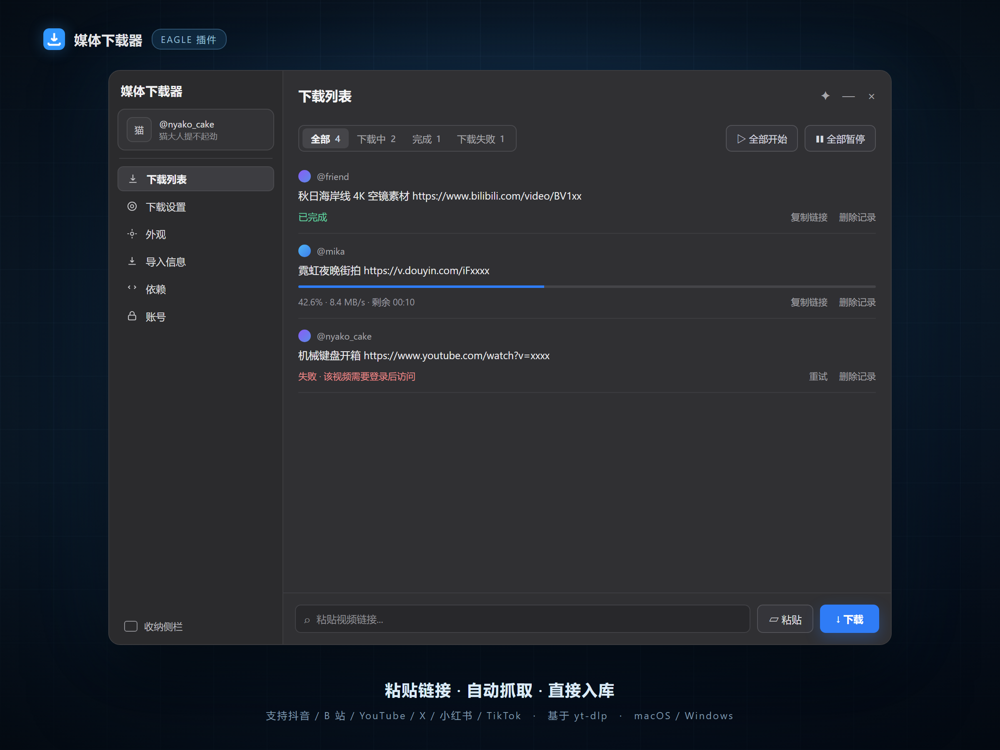
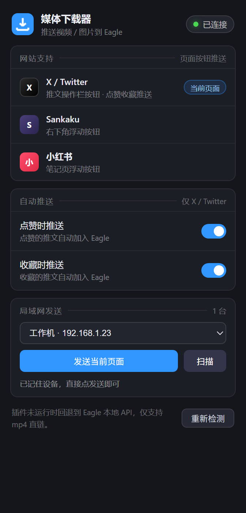

# Edge Media Download NEW

English | [中文](./README.md)

A downloader that pulls videos and images from the web straight into [Eagle](https://eagle.cool): an Eagle plugin (「媒体下载器」, Media Downloader) plus an Edge extension.

Current version **1.0.0**. This is an independent build reconstructed in a local project: the interface was rebuilt against Eagle's native preferences and the download pipeline was reworked around real use, with no fork relationship to the upstream `eagle-video-downloader` and no updates taken from it. The version number restarts at 1.0.0.

## Supported platforms

YouTube, X / Twitter, TikTok, Bilibili, Instagram, Pinterest, Dribbble, Vimeo, Sankaku, Xiaohongshu and [many more](https://github.com/yt-dlp/yt-dlp/blob/master/supportedsites.md).

X / Twitter, Sankaku, Xiaohongshu, Pinterest, Dribbble, Bilibili, Vimeo and Instagram have dedicated adapters that also yield titles, authors, post text and topics; every other site goes through yt-dlp's generic path.

Image-only content works too: Pinterest pins are saved at full resolution, multi-image tweets are saved one by one, and images inside Sankaku posts and Xiaohongshu notes are downloaded as well. When one post contains several files, each is downloaded instead of only the first.

## Features

The first run installs yt-dlp from the Dependencies page, audio and video are muxed by Eagle's official FFmpeg plugin, and finished downloads are imported into Eagle with title, author and source URL saved as metadata. The interface switches between Chinese and English, and downloads report live progress, speed and time remaining.

The interface is a one-to-one reconstruction of Eagle's native preferences with six themes plus an option to follow Eagle's own appearance. The queue supports filters with counts, start-all and pause-all, retry of failed items and failure records that survive a restart. X likes, bookmarks and links shared in direct messages can be polled on a schedule, and a built-in LAN bridge lets devices on the same network exchange links.

## In detail

### Downloading and sites

- Paste any video URL to enqueue it; yt-dlp fetches the original file and imports it into Eagle with title, author and source URL metadata
- Restricted X / Twitter content: for NSFW or age-gated tweets that answer with a TweetTombstone when signed out, the plugin resolves the direct link through a public endpoint and hands it to yt-dlp; ordinary tweets keep the normal path
- Xiaohongshu: the note title becomes the filename, the body becomes the annotation and topics become tags, with the original image preferred (HEIC is converted to JPEG); the link must carry `xsec_token`
- Sankaku: videos and images from posts; an accessToken can be entered on the account page to reach login-only content
- Pinterest: both video pins and image-only pins, with the highest-resolution original fetched automatically
- Resolution and frame-rate caps: 4K / 2K / 1080p / 720p / 480p and 60 / 30 fps, falling back to the next best available option when the exact tier is missing
- Multi-threaded downloads: threads can be auto / 8 / 16 / 32 / 64 / 128, mapped to yt-dlp's `--concurrent-fragments` and applied to HLS / DASH streams, while direct MP4 links stay single-connection
- Live progress: percentage, speed and time remaining while downloading; merge and convert stages show an estimate, or an indeterminate animation when no estimate is possible

### Download list

- Filters (All / Downloading / Completed / Failed) show live counts, and the toolbar stays fixed while the list scrolls
- Start all also retries failed items; pause all stops everything in progress; hovering a row reveals a delete control that is disabled while the task is still downloading or resolving
- Failed items are persisted locally, survive a restart, and disappear once the download succeeds or the record is deleted
- When a record exists but the asset is gone from the Eagle library, clicking it re-downloads and imports the file
- Links pushed by the extension or picked up by scheduled capture are enqueued silently, without interrupting what you are doing
- A short sound plays when an item joins the list; the bundled sound is the default and a custom file can be selected

### Interface

- Six sidebar pages — Download List, Download Settings, Appearance, Import Info, Dependencies, Account — that collapse into an icon rail; while collapsed the title becomes a 2×2 block of the four characters 「媒体下载器」, revealed character by character when expanded
- The title bar provides pin-on-top, minimize and close; the window is draggable and resizable (minimum 760 × 560) and remembers its size and position
- Appearance offers light, light gray, gray, dark, deep blue and purple themes, or an option to follow Eagle's current theme
- A "Show account" switch controls whether the X account card appears in the top-left corner, with a "Reset window size" button below it
- Concurrent downloads can be set to 3 / 6 / 9 / 16 / 32; the paste button on the left of the input reads the clipboard and extracts the link from mixed text and links
- Changes on the Download Settings page take effect immediately, with no restart

### Accounts and automatic capture

- X / Twitter connects with the `auth_token` and `ct0` values from your browser cookies, with save-and-test and sign-out supported; once connected the top-left corner shows the real avatar, display name and handle
- X Chat messages are end-to-end encrypted, so the 4-digit chat passcode must be entered on the account page before the plugin can decrypt messages from friends
- Like and bookmark capture can be toggled separately, with intervals from 30 seconds to 3 hours and at most 100 items per category per round; the plugin performs one catch-up about 10 seconds after start and then follows the selected interval
- Friend capture polls direct messages for shared links, can be limited to selected conversations, and runs on a 2 / 4 / 6 / 8 / 10 minute interval; each link is captured once and shares de-duplication rules with likes and bookmarks
- Account details, capture switches and capture history are scoped to the Eagle library and follow it when you switch libraries
- Every scheduled job can be run immediately with the "Test capture" button

### Import info rules

- Twitter rules are split into Name, Annotation and Tags columns, each offering author ID, tweet ID, handle, text and full name; the up and down arrows on each row set the order, saved independently per column
- Name: selected fields are joined in order with " - ", truncated at 150 characters, with illegal filename characters replaced; with nothing selected it falls back to "tweet text - @handle"
- Annotation: truncated at 5000 characters; selecting any field makes the annotation composed only of selected fields, so tick "text" to keep the tweet body
- Tags: each selected field becomes its own tag, ordered after the site tag and truncated at 100 characters each; when two adjacent rows are both selected, the chain button between them merges them into one tag
- The Xiaohongshu tag switch decides whether note topics become Eagle tags; the "Distinguish multiple files" switches (one for Twitter, one for Xiaohongshu) control whether names get a " (1/N)" suffix when a post yields several files, and when off the files share one name
- At most 30 tags are written per import, and a tag duplicating a site tag (case-insensitively) is kept only once

### LAN

- The plugin serves `GET /ping`, `GET /peers` and `POST /ingest` on `0.0.0.0:43110`, reachable from the local extension and from other devices on the network
- `/peers` scans the local subnet and returns the devices currently running the plugin
- Only https links on the x.com / twitter.com / video.twimg.com / pbs.twimg.com / sankaku / xiaohongshu allowlist are accepted, with a 16 KB request body limit
- A 503 is returned while dependencies are not ready; accepted links are enqueued and the plugin window is brought up
- Only the link travels, nothing is downloaded on the sending side; the receiving side needs the plugin open and inbound access to 43110

## Browser extension (Edge / Chromium)



The companion extension lives in `edge-extension/` (Manifest V3).

To install, open `edge://extensions`, enable Developer mode, click "Load unpacked" and select the `edge-extension/` folder.

What it provides:

- X / Twitter: a "Save to Eagle" button and a "Share to LAN device" button in the tweet action bar, plus a LAN entry in the tweet share menu
- Links are pushed automatically when you like or bookmark a post, each toggled separately in the popup
- Sankaku: a floating button in the bottom-right corner of a post page
- Xiaohongshu: a floating button on note pages that saves the note (title as filename, text and topics imported into Eagle); the link must carry `xsec_token`
- The popup is grouped by site and by function, and can scan for and remember LAN devices before sending the current page link
- When the plugin is closed the extension tries to wake it through Eagle's local API and retries the push
- When the plugin is unavailable, direct media links fall back to Eagle's local API at `127.0.0.1:41595`

## Installation

Eagle plugin: download `Edge-Media-Download-NEW-v<version>.eagleplugin` from [Releases](https://github.com/nyako-cake/Edge-Media-Download-NEW/releases) and double-click it, or use Eagle's Plugins → Developer Options → Import local project.

Cloning the repository and importing the `Plugin/` folder also works, since `Plugin/dist/plugin.js` is committed and no build step is required first.

Edge extension: unzip `Edge-Media-Download-NEW-extension-v<version>.zip` from the Release and load it unpacked as described above.

## First run

The first launch asks for yt-dlp (about 30 MB) to be installed from the Dependencies page. ffmpeg comes from Eagle's official FFmpeg plugin; when it is missing, the Dependencies page offers a button that opens Eagle's store.

## Usage

1. Copy a page URL
2. Paste it into the input field (the paste button on its left identifies the link and starts the download)
3. Or use the save button in an X / Twitter action bar, like or bookmark a post and let the extension push it, or click the floating button on a Xiaohongshu note
4. The file is imported into Eagle once the download completes
5. For batches, use "Start all", or enable scheduled capture on the Account page

## FAQ

- "yt-dlp is not installed": reinstall it from the Dependencies page; if GitHub is unreachable, place `yt-dlp.exe` in the plugin's `bin/` folder and restart the plugin
- No speed or a progress bar that does not move: check the system proxy first, since yt-dlp inherits it
- The extension says to open the Eagle plugin first: the plugin window is closed or dependencies are not ready; open it and retry
- Restricted tweets (NSFW or age-gated) fail to download: make sure the plugin window is open, as it resolves direct links through a public endpoint
- The percentage jumps during merging: merge progress is estimated from output file growth, so small files may go from 0% straight to 100%
- Friend capture finds nothing: check that `auth_token`, `ct0` and the chat passcode are filled in and that the target conversations are ticked under "Select chats"; only links sent by friends are picked up
- No devices found on the LAN: confirm both machines are on the same subnet, the receiving side has the plugin open, and Windows Firewall allows inbound traffic on 43110
- Duplicate downloads: the plugin de-duplicates tweets, posts and notes, so the same content is downloaded only once within 24 hours; if duplicates persist, check whether extension pushes and scheduled capture are both enabled for the same source
- Xiaohongshu says the note cannot be read: the link must include `xsec_token`; copy the full link from the app's share menu or the address bar, as a bare note ID cannot be read anonymously

## Development

```bash
npm install      # install dependencies
npm run build    # build the plugin into Plugin/dist/plugin.js
npm run dev      # development mode (rebuild on change)
npm run package  # build and pack 媒体下载器.eagleplugin
```

Sources live in `js/`, and the interface is `Plugin/index.html` (inlined styles) together with `Plugin/native-skin.css`. The project uses esbuild for bundling and i18next for localisation, yt-dlp for extraction and Eagle's official FFmpeg plugin for muxing.

`Plugin/dist/plugin.js` is a build artifact but is committed on purpose: a fresh clone can import `Plugin/` into Eagle and run without building first. Every change under `js/` must be rebuilt with `npm run build` and the updated bundle committed alongside it, or the committed artifact drifts from the sources.

The release workflow (`.github/workflows/build.yml`) rebuilds and packages both the plugin and the extension when a `v*` tag is pushed.

## Data and ports

- Plugin ID `e6a9bdad-237b-4f06-a4e8-67b46fed5ad6`
- Storage key prefix `Edge-Media-Download-NEW.` (legacy `eagle-video-downloader.` keys are migrated on first start)
- Bridge port `43110`: `/ping`, `/ingest`, `/peers`

## Requirements

Eagle 4.0 or later, Eagle's official FFmpeg plugin, and a network connection.

## License

MIT

This tool is intended for personal use; please respect each platform's terms of service and copyright law.

## Credits

The project started from [fansanqiu](https://github.com/fansanqiu)'s Eagle video downloader, itself derived from [OlivierEstevez/eagle-twitter-video-downloader](https://github.com/OlivierEstevez/eagle-twitter-video-downloader). Thanks to the original authors for their pioneering work. Video extraction and downloading are powered by [yt-dlp](https://github.com/yt-dlp/yt-dlp), muxing and transcoding by [FFmpeg](https://ffmpeg.org), and X Chat message decryption relies on `juicebox-sdk`.
