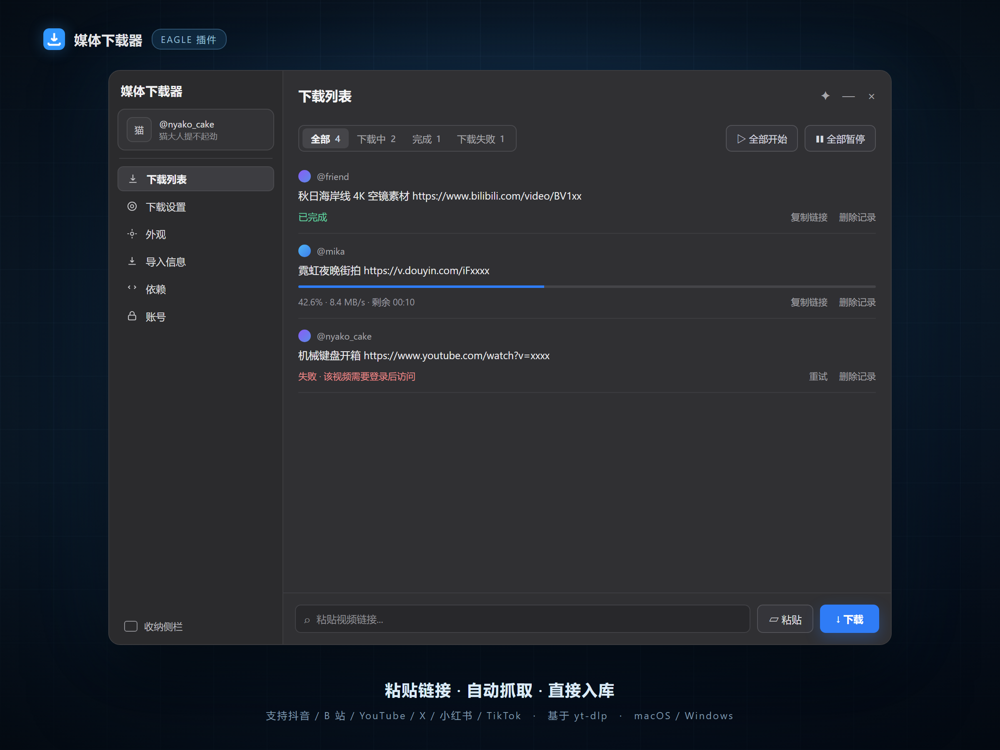
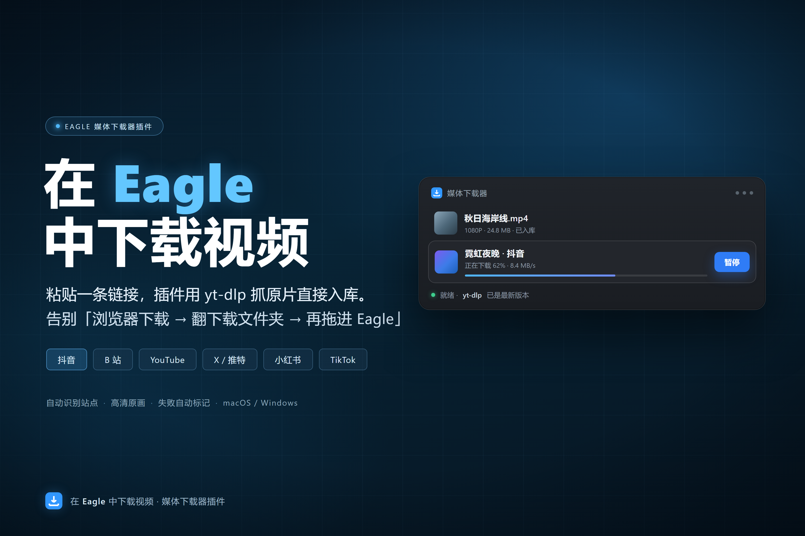
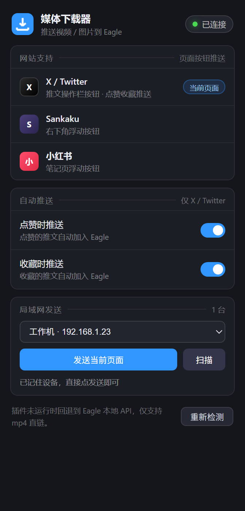

# Edge Media Download NEW

把网页里的视频、图片直接抓进 [Eagle](https://eagle.cool) 的下载器：一个 Eagle 插件 + 一个 Edge 扩展。

本项目是独立开源项目，代码与上游 `eagle-video-downloader` 不构成 fork、不跟随上游更新，版本从 **1.0.0** 重新起算。

## 界面







## 功能

**Eagle 插件（媒体下载器）**

- 粘贴视频链接加入下载队列，基于 `yt-dlp` 抓取原片并入库，自动写入标题、作者、来源链接等元数据
- 站点适配：X / Twitter、Sankaku、小红书、B 站、YouTube、Vimeo、Instagram、Pinterest、Dribbble 等 yt-dlp 支持的站点
- 队列能力：全部开始 / 全部暂停、并发数与线程数、失败原因中文化、失败项标记与「全部开始重试失败项」
- 好友抓取：定时检查 X 私信里分享的视频链接，命中自动入队，同一链接只抓一次
- 界面：一比一还原 Eagle 原生偏好设置，支持明暗主题、侧栏折叠动画、固定工具条、筛选计数、加入列表提示音（可自定义音效）
- 局域网：内置 ingest 桥（`43110`），同网段设备可互发链接

**Edge 扩展**

- 页面内推送：X 推文操作栏按钮、Sankaku 与小红书右下角浮动按钮
- 自动推送：点赞 / 收藏时自动把该推文加入 Eagle
- 局域网发送：把当前页面链接发给同网段另一台运行本插件的设备
- 插件未运行时回退到 Eagle 本地 API（`41595`），仅支持 mp4 直链

## 安装

### Eagle 插件

1. 下载 Release 里的 `Edge-Media-Download-NEW-v1.0.0.eagleplugin`
2. Eagle 中双击安装，或解压到 `Eagle/Plugins/<插件 id>`
3. 首次使用会自动下载 `yt-dlp`；音视频合并依赖 Eagle 内置 `ffmpeg`

### Edge 扩展

1. 下载 Release 里的 `Edge-Media-Download-NEW-extension-v1.0.0.zip` 并解压
2. Edge 打开 `edge://extensions`，开启「开发人员模式」
3. 点「加载解压缩的扩展」，选择解压后的目录

## 构建

```bash
npm install
npm run build     # 打包 js/ → Plugin/dist/plugin.js
npm run package   # 生成 .eagleplugin
```

## 目录

```
js/             插件源码（下载器、站点适配、X 私信抓取、UI）
Plugin/         Eagle 插件成品目录（index.html、dist、assets、_locales）
edge-extension/ Edge 扩展（popup、content script、background）
```

## 数据与端口

- 存储键前缀 `Edge-Media-Download-NEW.`（旧版 `eagle-video-downloader.` 首次启动自动迁移）
- 桥接端口 `43110`：`/ping`、`/ingest`、`/peers`

## 致谢

- 最初版本来自 [fansanqiu](https://github.com/fansanqiu) 的 Eagle 视频下载器
- 下载核心使用 [yt-dlp](https://github.com/yt-dlp/yt-dlp)

## License

MIT
